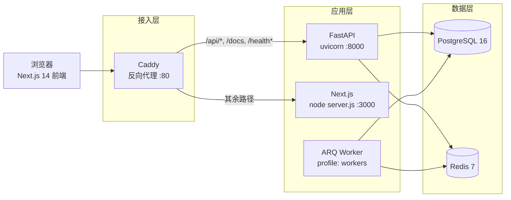

# hpc-platform

HPC 作业调度与计费管理平台（FastAPI + PostgreSQL + Redis 增强）。

当前进度：**M1 骨架与认证 ✅ 完成** ｜ **M2 进行中**（已完成 D11–D21：F2 节点域、F3 配额域、F4 作业模型/提交/取消/列表/详情 + 模拟调度器）｜ 下一步 D22 作业结束流转与计费流水

> **README 约定**：开工先立骨架（架构图 / 技术选型 / 量化指标占位），每完成一个里程碑补一节。

---

## 1. 架构

### 1.1 架构图



### 1.2 目录结构

```
hpc-platform/
├── apps/
│   ├── api/                    # FastAPI 后端
│   │   ├── app/
│   │   │   ├── core/           # config / security / redis / rate_limit / errors
│   │   │   ├── db/             # Base、异步引擎、get_db
│   │   │   ├── models/         # SQLAlchemy 2.0 ORM（users / roles / nodes / groups / quotas / jobs）
│   │   │   ├── schemas/        # Pydantic v2 出入参
│   │   │   ├── services/       # 业务逻辑（auth / user / node / quota / job / scheduler）
│   │   │   ├── routers/        # HTTP 层（auth / users / nodes / quotas / jobs / health）
│   │   │   ├── deps/           # 依赖注入（会话、Redis、当前用户、RBAC）
│   │   │   ├── workers/        # ARQ 后台任务（调度轮询 + ping）
│   │   │   └── main.py         # 应用工厂
│   │   ├── alembic/            # 迁移（users/roles → nodes → groups/quotas → jobs）
│   │   └── tests/              # pytest（SQLite + fakeredis，无需外部依赖）
│   └── web/                    # Next.js 14 (App Router) 前端
│       ├── src/app/            # 登录页 + 布局壳 + 概览 + 用户管理
│       ├── src/lib/api/        # openapi-typescript 生成的类型 + 类型化 client
│       └── scripts/gen-api.mjs # 从 /openapi.json 重新生成类型
├── deploy/Caddyfile            # 反向代理：/api → FastAPI，其余 → Next.js
├── docker-compose.yml          # api + postgres + redis + web + caddy
├── Makefile                    # 一键起停、迁移、种子、测试
└── .github/workflows/ci.yml    # ruff + pytest + web build + compose 校验
```

### 1.3 关键链路

| 链路 | 过程 |
| --- | --- |
| 登录 | Browser → Caddy → `POST /api/v1/auth/login` → **限流**(ZSET 滑动窗口) → bcrypt 校验 → 签发 access + refresh |
| 受保护请求 | `Bearer access` → 验签 / 类型 / 过期 → **jti 黑名单查 Redis** → 加载用户 + 角色 → RBAC 判定 |
| 登出 | access（及可选 refresh）的 `jti` 写黑名单，**TTL = 剩余有效期**，到期自动回收 |
| 刷新 | refresh 验签 → 旧 `jti` 立即拉黑（**轮换**）→ 签发新 token 对 |

---

## 2. 技术选型

| 领域 | 选型 | 理由 |
| --- | --- | --- |
| 后端框架 | FastAPI + Pydantic v2 | 原生异步、OpenAPI 自动生成，前端类型可直接复用 |
| ORM / 迁移 | SQLAlchemy 2.0（async）+ Alembic | 类型化 ORM，异步 IO；迁移可回滚 |
| 数据库 | PostgreSQL 16 | 关系约束强、JSONB/窗口函数为后续计费统计留空间 |
| 缓存 / 限流 | Redis 7 | 滑动窗口（ZSET）与 JWT 黑名单都需要低延迟 + TTL 语义 |
| 认证 | PyJWT + bcrypt | JWT 无状态、refresh 轮换；bcrypt 加盐哈希 |
| 后台任务 | ARQ（Redis 队列） | 复用已有 Redis，无需再引入 RabbitMQ 等中间件 |
| 前端 | Next.js 14（App Router）+ TS + Tailwind | 与后端同语言的类型闭环；App Router 便于后续 RSC |
| API 类型 | openapi-typescript | 由 `/openapi.json` 生成 `schema.d.ts`，避免手写接口类型漂移 |
| 网关 | Caddy | 配置极简、自动压缩；同源 `/api` 免 CORS 复杂度 |
| 容器 | Docker Compose + Makefile | 一条 `make up` 起全栈，环境一致 |
| CI | GitHub Actions | ruff + pytest + next build + compose 校验 |

---

## 3. 量化指标

| 指标 | 目标 | 当前实测 | 说明 |
| --- | --- | --- | --- |
| 单元测试 | 全绿 | **96 passed**（≈5.6s） | SQLite + fakeredis，无需外部依赖 |
| 后端规范 | 0 error | **ruff check / format 全过** | 61 个文件已格式化（不含迁移） |
| 配额并发防超卖 | 20 并发无一超扣 | **恰好 10 次成功，`gpu_used=100 ≤ gpu_limit`** | 文件库多连接真并发（非 StaticPool 串行） |
| 作业提交原子性 | 配额不足不落库 | **409 后 `gpu_used` 回滚、`jobs` 表 0 行** | 预扣与入队同事务 |
| 取消作业幂等 | 重复取消不二次返还 | **第二次 409，`gpu_used` 保持 0** | 条件 `UPDATE` + `rowcount` 判定 |
| 前端类型/构建 | 构建成功 | **typecheck + lint + build 全过** | Next 14.2.15，对着真实 OpenAPI schema 校验 |
| 前端首屏 JS | — | **87.2 kB** | `next build` 输出（shared chunks） |
| 迁移可用性 | upgrade/downgrade 双向 | **已验证** | SQLite 上建表 + roles 种子 + 回滚 |
| 登录接口 P95 延迟 | < 200ms | 待测 | 需 load 压测，M1 未做 |
| 限流准确率 | 100% | 功能已覆盖，并发待测 | 仅单测覆盖触发路径，无并发压测 |
| 镜像体积 | — | api **825 MB** / web **223 MB** | `docker images` 实测 |
| 镜像构建时长（冷启动） | — | 待测 | 首次构建含基础镜像拉取，本机未单独计时 |
| 测试覆盖率 | ≥ 80% | 待接入 coverage | 尚未接入 pytest-cov |

> 未实测项保持「待测」占位，不做估算。

---

## 4. 里程碑

### M1 骨架与认证 —— ✅ 已完成

**任务项**

- [x] monorepo 初始化：`apps/web`(Next.js 14) + `apps/api`(FastAPI) + `deploy/`
- [x] FastAPI 分层骨架：`routers/ services/ models/ schemas/ core/ workers/`，pydantic-settings 管环境变量
- [x] Alembic 初始化 + `users/roles` 表；JWT（access + refresh）+ bcrypt；RBAC 依赖注入（admin / user）
- [x] Redis 增强：登录限流（滑动窗口）+ JWT 黑名单（登出即时失效）
- [x] Docker Compose：api + postgres + redis + web + caddy，Makefile 一键起
- [x] Next.js：登录页 + 布局壳 + openapi-typescript 生成 API client
- [x] CI：ruff + pytest + build

**交付物**

- 后端：`apps/api/app/**`、`apps/api/alembic/**`、`apps/api/tests/**`
- 前端：`apps/web/src/**`、`apps/web/src/lib/api/schema.d.ts`（生成物）
- 编排：`docker-compose.yml`、`deploy/Caddyfile`、`Makefile`、`.env.example`
- CI：`.github/workflows/ci.yml`

**验收结论**

| # | 验收项 | 结论 |
| --- | --- | --- |
| 1 | `compose up` 后两角色登录 | ✅ Docker Desktop 29.8.2 实测：浏览器 UI 用 admin 登录 → 进入 `/dashboard`，`login` / `me` 均 `200` |
| 2 | 越权返回 403 | ✅ 单测 + compose 实测（user → `/api/v1/users` 返回 `403`，admin 返回 `200`） |
| 3 | 限流生效 | ✅ 单测 + compose 实测：前 5 次 `401`，第 6 次 `429`（`Retry-After: 59s`） |
| 4 | 登出后旧 token 失效 | ✅ 单测 + compose 实测（`/auth/me` `200` → logout `200` → 同 token `/auth/me` `401`） |

**关键实现**

- 限流：[`core/rate_limit.py`](apps/api/app/core/rate_limit.py) —— ZSET + Lua 原子脚本，键 `ratelimit:login:{ip}:{identifier}`，成功即重置。
- 黑名单：[`core/redis.py`](apps/api/app/core/redis.py) —— `SETEX` 且 TTL = `exp - now`，键自过期、无需清理任务。
- RBAC：[`deps/auth.py`](apps/api/app/deps/auth.py) —— `require_roles("admin")`，**以数据库角色为准**而非信任 token 内声明。
- 令牌轮换：[`services/auth_service.py`](apps/api/app/services/auth_service.py) —— 刷新时先拉黑旧 refresh 的 `jti`。
- 前端类型闭环：[`web/scripts/gen-api.mjs`](apps/web/scripts/gen-api.mjs) → [`schema.d.ts`](apps/web/src/lib/api/schema.d.ts) → [`client.ts`](apps/web/src/lib/api/client.ts)。

**遗留 / 风险**

- 前端 token 暂存 `localStorage`，加固方向为 refresh 落 httpOnly + SameSite=Strict Cookie（含 CSRF 防护）。
- `worker` 已接入调度轮询（F4.3），但默认在 `profile: workers` 下，需 `docker compose --profile workers up -d` 才会启动。
- 尚未接入覆盖率统计与并发压测。

### M2 资源 / 配额 / 作业 / 计量 —— ⏳ 进行中（D11–D21 完成）

> 计划与逐日进度见 [`docs/项目①开发计划_HPC作业调度与计费管理平台.md`](docs/项目①开发计划_HPC作业调度与计费管理平台.md) 第 8 节。

**已完成**

- [x] F2 节点域：`nodes` 模型 + 迁移 + CRUD（admin）+ 只读资源视图（含 `gpu_free`）
- [x] F3.1 配额模型：`groups` / `user_groups` / `quotas` + 迁移
- [x] F3.2 配额扣减（防超卖核心）+ 20 并发测试
- [x] F3.3 配额返还、F3.4 配额管理、F3.5 配额查询接口
- [x] F4.1 作业模型：`jobs` 状态机 + CHECK + 索引 + 迁移
- [x] F4.2 作业提交：字段级校验 → 配额预扣 → 入队（同事务）
- [x] F4.4 取消作业：条件 `UPDATE` + `rowcount`，终态 409，取消返还预扣
- [x] F4.5 作业列表：分页 + 状态/时间筛选，user 仅见自己、admin 见全部
- [x] F4.6 作业详情：资源/起止/消耗卡时（按分钟向上取整）+ mock 日志
- [x] F4.3 模拟调度器（排队→运行）：FIFO + 最空闲节点 + 原子占卡，worker 2s 轮询

**交付物**

- 后端：`app/models/{node,group,quota,job}.py`、`app/schemas/{node,quota,job}.py`、`app/services/{node_service,quota_service,job_service,scheduler_service}.py`、`app/routers/{nodes,quotas,jobs}.py`、`app/workers/{tasks,settings}.py`
- 迁移：`alembic/versions/0002_nodes.py`、`0003_groups_quotas.py`、`0004_jobs.py`
- 测试：`tests/test_nodes.py`、`tests/test_quota.py`、`tests/test_quota_endpoints.py`、`tests/test_job_model.py`、`tests/test_job_submit.py`、`tests/test_job_cancel_list.py`、`tests/test_job_detail.py`、`tests/test_scheduler.py`

**验收结论**

| # | 验收项 | 结论 |
| --- | --- | --- |
| 1 | F2.2 下线节点不再接收新作业 | ✅ `status=draining` 生效（调度器侧过滤在 D21 接入） |
| 2 | F3.1 一个用户组一条配额记录 | ✅ `quotas.group_id` 唯一索引 |
| 3 | F3.2 20 并发提交不超扣 | ✅ 恰好 10 次成功、`gpu_used=100 ≤ gpu_limit` |
| 4 | F3.4 调低配额不杀在跑作业 | ✅ 仅改上限；且不得低于已用（409） |
| 5 | F3.5 配额查询数值与扣减一致 | ✅ `/quotas/me` 返回 `gpu_available` |
| 6 | F4.2 超上限字段返回 422 + 明确字段 | ✅ 组级上限与静态上限两条来源均返回 `detail[].loc` |
| 7 | F4.2 配额不足 409 且不落库 | ✅ 预扣+入队同事务，409 后 `gpu_used` 回滚、`jobs` 0 行 |
| 8 | F4.4 终态作业取消返回 409 | ✅ 条件 `UPDATE` + `rowcount`；重复取消不二次返还 |
| 9 | F4.5 user 仅见自己、admin 见全部 | ✅ 列表强制按 `user_id` 过滤（非 admin） |
| 10 | F4.6 详情字段齐全 | ✅ 资源/起止/`gpu_minutes`（2 卡 × 30 分钟 = 60）/mock 日志；仅本人或 admin |
| 11 | F4.3 排队作业进入 Running | ✅ 单次调度扫描即流转并占卡（worker 2s 轮询；端到端未实测） |

**关键实现**

- 防超卖：[`quota_service.py`](apps/api/app/services/quota_service.py) —— 条件原子 `UPDATE ... WHERE gpu_used + :n <= gpu_limit` + `rowcount` 判定，杜绝读-改-写竞态；`reserve`/`release` 不 commit，由调用方保证「预扣 + 入队」同事务。
- 作业提交：[`job_service.py`](apps/api/app/services/job_service.py) —— 成员校验 → 组级上限校验（422 字段级）→ 原子预扣（409）→ 入队，③④ 同一事务提交。
- 取消作业：条件 `UPDATE ... WHERE status IN ('queued','running')` + `rowcount` 判定，终态 409；取消即返还预扣，实际卡时由 `usage_events` 计费（D22）。
- 调度器：[`scheduler_service.py`](apps/api/app/services/scheduler_service.py) —— FIFO 扫描 queued，选最空闲 online 节点，条件 `UPDATE nodes` 原子占卡后再把作业置 running；每作业独立事务，worker 起始时启动 2s 轮询循环。
- 数据兜底：[`quota.py`](apps/api/app/models/quota.py) 的 CHECK `gpu_used <= gpu_limit`，应用层有 bug 也越不过去。
- 并发用例：[`test_quota.py`](apps/api/tests/test_quota.py) 用**文件库多连接**制造真并发（in-memory + `StaticPool` 单连接会串行化，测不出竞态）。

**遗留 / 风险**

- 前端尚未接入 F2/F3/F4 页面（列表页 D28、管理页 D29–D32）。
- 与 PRD 的偏差（`PUT` vs `PATCH`、`/healthz` vs `/health`、限流窗口 5min vs 60s）已登记在开发计划第 8 节，待统一口径。

### M3 …… —— ⏳ 待规划

> 同上。

---

## 5. 快速开始

```bash
make up        # 生成 .env → docker compose up -d --build
make migrate   # 应用数据库迁移（容器启动时也会自动执行）
make seed      # 创建演示账号
```

> 构建镜像时若 npm / PyPI 拉取慢或被墙，可在 `.env` 覆盖构建源（默认指向官方源，仓库保持可移植）：
> `NPM_REGISTRY=https://registry.npmmirror.com`、`PIP_INDEX_URL=https://pypi.tuna.tsinghua.edu.cn/simple`
> （Docker 拉基础镜像慢可另在 `~/.docker/daemon.json` 配 `registry-mirrors`。）

访问：

| 入口 | 地址 |
| --- | --- |
| 前端 | http://localhost |
| API 文档 | http://localhost/docs |
| OpenAPI | http://localhost/openapi.json |
| 健康检查 | http://localhost/health · /health/ready |

演示账号（来自 `.env.example`）：

| 角色 | 账号 | 密码 |
| --- | --- | --- |
| admin | `admin@hpc.local` / `admin` | `admin12345` |
| user | `user@hpc.local` / `user` | `user12345` |

> 数据库 / Redis 端口（5432 / 6379）与 API（8000）、Web（3000）均已映射到宿主机，便于本地调试。

### 本地开发（不用 Docker）

推荐做法：**基础设施仍用 Docker，后端与前端在本机手动跑** —— 依赖版本与生产一致，前端又有热更新。

> 手动起之前必须先腾端口：容器版全栈会占用 8000 / 3000 / 80。

```powershell
# 0) 只保留基础设施，释放 8000 / 3000 / 80
docker compose stop api web caddy
docker compose up -d postgres redis

# 1) 后端（新开一个终端）
cd apps/api
python -m venv .venv
.\.venv\Scripts\Activate.ps1     # 被执行策略拦则先跑 Set-ExecutionPolicy -Scope Process -ExecutionPolicy Bypass
pip install -e ".[dev]"
alembic upgrade head             # 幂等：已到 head 会提示 already up to date
python -m app.initial_data       # 幂等：重复执行不会重复建账号
uvicorn app.main:app --reload --port 8000

# 2) 前端（再开一个终端）
cd apps/web
npm install
Copy-Item .env.local.example .env.local
npm run dev                      # :3000；/api/** 由 next.config.mjs 的 rewrite 转发到 :8000
```

访问 <http://localhost:3000>（手动跑时**不需要** Caddy）；API 文档在 <http://localhost:8000/docs>。

> 不想激活 venv 的话，把上面的 `pip` / `alembic` / `python` / `uvicorn` 换成 `.\.venv\Scripts\python.exe -m <命令>` 即可。

**注意事项**

| 事项 | 说明 |
| --- | --- |
| `.env` 的查找位置 | [`config.py`](apps/api/app/core/config.py) 的 `env_file=".env"` 相对**运行目录**解析。在 `apps/api` 下运行且该目录无 `.env` 时全用代码默认值（`hpc/hpc/hpc@localhost:5432`、`redis://localhost:6379/0`），恰好与 Docker 起的基础设施一致，可直接跑。要沿用仓库根 `.env` 的自定义值：`Copy-Item ..\..\.env .env`。 |
| JWT 密钥不一致 | 本地与容器两条路 `JWT_SECRET_KEY` 不同时，切换后旧 token 立即失效（401），属预期而非缺陷。 |
| 端口冲突 | 不先 `stop` 会报 `[Errno 10048]`。若想与容器并存：后端换 `--port 8001`，并把 `apps/web/.env.local` 的 `API_PROXY_TARGET` 改为 `http://localhost:8001`。 |
| Python 版本 | `requires-python>=3.11`；若 `pip install` 报缺 wheel 或需要编译，改用 3.12 建 venv。 |

---

## 6. 接口一览（`/api/v1`）

| 方法 | 路径 | 权限 | 说明 |
| --- | --- | --- | --- |
| POST | `/auth/login` | 匿名 | 登录，**限流**；返回 access + refresh |
| POST | `/auth/refresh` | 匿名 | 刷新令牌（**轮换**，旧 refresh 立即失效） |
| POST | `/auth/logout` | 登录 | 登出，access/refresh 的 `jti` 进入黑名单 |
| GET | `/auth/me` | 登录 | 当前用户资料（含角色） |
| GET | `/users` | admin | 用户列表 |
| POST | `/users` | admin | 创建用户 |
| GET / PATCH | `/users/{id}` | admin | 查询 / 更新用户 |
| GET | `/nodes` · `/nodes/{id}` | 登录 | 节点列表 / 详情（只读资源视图，含 `gpu_free`） |
| POST / PATCH / DELETE | `/nodes` · `/nodes/{id}` | admin | 节点增删改（含上下线 / draining） |
| GET | `/quotas/me` | 登录 | 我所属各组的配额余量 |
| GET / PATCH | `/quotas/{group_id}` | admin | 查询 / 调整组配额 |
| POST | `/jobs` | 登录 | 提交作业（校验 + 配额预扣 + 入队，201） |
| GET | `/jobs` | 登录 | 作业列表（分页 + 状态/时间筛选；user 仅自己、admin 全部） |
| GET | `/jobs/{id}` | 本人/admin | 作业详情（资源/起止/消耗卡时 + mock 日志） |
| POST | `/jobs/{id}/cancel` | 本人/admin | 取消作业（终态 409，返还预扣） |
| GET | `/health` · `/health/ready` | 匿名 | 存活 / 就绪（检查 PG + Redis） |

限流与黑名单的手工复现脚本：

```bash
# 1) 限流：前 5 次 401，第 6 次 429
for i in $(seq 1 6); do
  curl -s -o /dev/null -w "%{http_code}\n" -X POST http://localhost/api/v1/auth/login \
    -H 'Content-Type: application/json' \
    -d '{"username":"admin@hpc.local","password":"wrong"}'
done

# 2) 登出后旧 token 立即失效
TOKEN=$(curl -s -X POST http://localhost/api/v1/auth/login -H 'Content-Type: application/json' \
  -d '{"username":"admin@hpc.local","password":"admin12345"}' | python -c "import sys,json;print(json.load(sys.stdin)['access_token'])")
curl -s -o /dev/null -w "me=%{http_code}\n" http://localhost/api/v1/auth/me -H "Authorization: Bearer $TOKEN"
curl -s -o /dev/null -w "logout=%{http_code}\n" -X POST http://localhost/api/v1/auth/logout -H "Authorization: Bearer $TOKEN"
curl -s -o /dev/null -w "me_after_logout=%{http_code}\n" http://localhost/api/v1/auth/me -H "Authorization: Bearer $TOKEN"
```

---

## 7. 埋点话术（评审要点）

**1. 为什么登录限流用「滑动窗口」而不是令牌桶？**

- 固定窗口计数器（`INCR` + `EXPIRE`）在窗口边界可被"2 倍超额"打穿：59s 打满、61s 再打满。
- 滑动窗口用 Redis **有序集合**存储每次命中（member 唯一、score=毫秒时间戳）：每次先 `ZREMRANGEBYSCORE` 清掉窗口外的成员，再 `ZCARD` 计数，因此"窗口"是连续滑动的，计数语义始终是"最近 N 秒内的命中数"。
- 整个"清理 → 计数 → 判定 → 写入"封装为一段 **Lua 脚本**（`core/rate_limit.py`），由 Redis 单线程原子执行，多副本并发下不会出现读改写竞争。
- 与令牌桶的取舍：滑动窗口**精确**、可解释，内存与请求数成正比（仅登录这种低频场景完全可接受）；令牌桶 O(1) 内存、允许受控突发，适合 QPS 极高的限流。登录限流更看重"精确与可解释"，故选滑动窗口。

**2. JWT 黑名单为什么放 Redis，而不是数据库？**

- JWT 本身无状态、无法"撤回"，登出/踢下线只能靠外部记录，属于典型的**短生命周期、高频读**数据。
- 用 Redis 的 `SETEX`，**TTL = 令牌剩余有效期**（`exp - now`）：令牌自然过期时黑名单键也自动过期，**无需任何清理任务**，也不会无限增长。
- 校验发生在每个受保护请求的鉴权阶段（`deps/auth.py` 的 `get_token_payload`），要求 O(1) 低延迟 —— Redis 天然合适；放关系库则每次请求都多一次 DB 往返，且要自己写清理逻辑。
- 生产上可进一步：Redis 集群/主从保证可用性，键加前缀 `jwt:blacklist:` 便于观测与批量排查。

**3. RBAC 如何落地？**

- 令牌里带 `roles` 声明便于前端展示，但**服务端以数据库为准**鉴权（`require_roles("admin")` 依赖会重新加载用户的角色），避免角色变更后旧令牌仍越权。
- 角色为多对多（`users ↔ roles`），依赖注入返回的用户对象以 `lazy="selectin"` 预加载角色，避免异步会话下的隐式 IO。

**4. 安全细节**

- 密码 bcrypt 加盐哈希，`bcrypt_rounds` 可配置（测试降到 4 提速，生产 12）。
- 登录时对不存在的用户也执行一次哈希校验，**抹平响应时间差**，降低账号枚举风险。
- refresh token **一次性轮换**：刷新时先把旧 `jti` 拉黑，再签发新对，被盗刷新令牌最多只能用一次。

---

## 8. 常用命令与 CI

```bash
make help                       # 列出全部目标
make up / down / logs / ps      # 编排
make migrate / makemigration m="..." / seed
make test / lint / fmt          # 质量保障
make gen-api                    # 从 OpenAPI 重新生成前端类型
make fe-dev / api-dev           # 分别起前端 / 后端
```

CI（`.github/workflows/ci.yml`）：后端 `ruff check` + `ruff format --check` + `pytest`；前端 `next lint` + `next build`；另校验 `docker compose config`。
